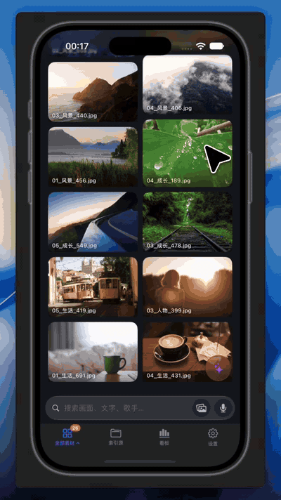
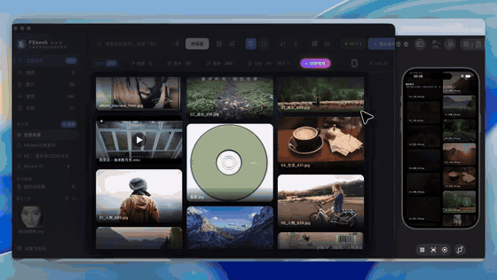

# FXseek 手机端 · FXseekMobile

> 把电脑上的 FXseek 素材库带在手机上：**局域网直连**，按画面、按声音检索，图片视频音频文档一屏浏览；
> 手机 ⇄ 电脑双向互传；手机保留一份**本地索引**，出了家门、断网也照样能搜。

**免费**、无内购、无账号。手机端只发安装包，App 源码不公开；电脑端在 **[FRr688/FXseek](https://github.com/FRr688/FXseek)**（同一个项目，那边是 macOS 版 + 手机端接口协议）。

<p align="center">
  
  
</p>

| 手机端界面 | 手机 ⇄ 电脑联机 |
|:--:|:--:|
| 网格浏览、音频卡片、按画面搜 | 设置里填电脑上那 6 位配对码，连上同一个库 |

---

## 电脑端 · macOS

<p align="center">
  
</p>

库在电脑上：**[FRr688/FXseek](https://github.com/FRr688/FXseek)** —— [下载 macOS 版](https://github.com/FRr688/FXseek/releases/latest)

---

## 它能做什么

- **局域网直连** —— 电脑开着 FXseek，手机输一次 6 位配对码，之后用长期令牌；请求只在局域网内走，**库本身不出家门**
- **搜得到** —— 文字搜、**以图搜图**、**以音搜素材**（一段哼唱 / 一句旋律也能找），搜索结果直接播放
- **看得全** —— 图片、视频、音频、文档都在一个网格里；视频能播、音频有锁屏控制（上一首 / 下一首）
- **传得动** —— 手机相册、录音、文件可以直接塞进电脑的索引源；电脑上的素材也能存到手机里带走
- **断网也能搜** —— 手机会保留一份本地索引，离家之后照样按内容找东西（端侧离线）
- **隐私优先** —— 不上传任何东西到云端；手机和电脑都在你自己的网里，配对码一次性、令牌可随时解绑

> 完整功能需要电脑端在同一局域网里跑着 FXseek（macOS 版，见 [电脑端仓库](https://github.com/FRr688/FXseek)）。
> 没连电脑时，手机上已有的内容仍然可以浏览和搜索。

---

## 装到 iPhone 上（5 步）

全程免费，不需要开发者账号。装好后有效期 **7 天**，到期重签一次即可（用 AltStore 会自动续签）。

1. **下载安装包** —— [Releases](../../releases) → `v1.1.0` → `FXseekMobile-1.1.0.ipa`（约 25 MB，[直链](https://github.com/FRr688/FXseekMobile/releases/download/v1.1.0/FXseekMobile-1.1.0.ipa)）
2. **装一个签名工具** —— [Sideloadly](https://sideloadly.io)（通用最稳，插线签一次）· [AltStore](https://altstore.io)（自动续签，同一个 Wi-Fi）· [TrollStore](https://github.com/opa334/TrollStore)（iOS ≤ 16.6.1，装完永久有效）
3. **把 App 签进手机** —— 数据线连上 iPhone、手机上点「信任此电脑」；打开 Sideloadly，把 ipa 拖进窗口；**Apple ID** 填你平时下 App 的那个账号（密码只发给苹果官方签名服务）；点 **Start**，出现 **Done** 就成了
4. **手机上允许它** —— 设置 → 通用 → **VPN 与设备管理** → 选你的 Apple ID → **信任**；（iOS 16+）设置 → 隐私与安全性 → 拉到底 → **开发者模式** → 打开，手机重启一次
5. **连上电脑** —— 打开电脑端 FXseek（工作模式或设置页都能看到 6 位配对码）→ 手机上填电脑的地址 + 配对码 → 连上

> ⚠️ **如果签名工具报 `Login failed (-80045)`：不是你弄错了。** 2026 年 10 月 12 日起苹果的账号验证接口在拒签，
> 全球所有侧载工具都报同一个错，报错点在「登录」那一步、还没走到签名。先把 Sideloadly 的 anisette 从 Local 换成
> Remote，或者用 [iloader](https://github.com/nab138/iloader/releases) 装同一个 ipa；别对同一个账号连续重试（苹果会限流）。

- 📖 **图文详情与常见问题**：[`dist/用户装包指引.md`](dist/用户装包指引.md)
- 🧩 **免电脑安装（AltStore 源）**：把下面这一行贴进 AltStore 的 `Browse → Sources → +`，之后就能一键安装、自动续签：

```
https://raw.githubusercontent.com/FRr688/FXseekMobile/main/dist/altstore.json
```

**完整性核对**（文件 24.9 MB / 26,143,063 字节，版本 1.1.0，构建 38）：

```bash
shasum -a 256 ~/Downloads/FXseekMobile-1.1.0.ipa
# 应为 47758b12f7f0db08fc8616bddc4c6c7d9cb807629df15c898f9cab834150e663
```

---

## 系统要求

| 项目 | 要求 |
|---|---|
| iOS | **15.0 及以上**（iPhone；iPad 可以兼容模式运行，界面按手机排版） |
| 电脑端 | macOS 版 FXseek（Apple 芯片 / Intel；13.0+），与手机在**同一个局域网** |
| 网络 | 只走局域网；不需要公网、不需要路由器端口映射 |

---

## 版本

| 版本 | 构建 | 日期 | 说明 |
|---|---|---|---|
| **1.1.0** | 38 | 2026-10-18 | 手机端**第一个版本**：局域网配对、浏览与检索、双向互传、本地索引、后台音频与锁屏控制 |

手机端版本号独立于电脑端，之后各自演进；接口协议以电脑端仓库的 [`docs/手机版协议.md`](https://github.com/FRr688/FXseek/blob/main/docs/手机版协议.md) 为准。

---

## 关于源码与授权

- 手机端 **App 源码不公开**，这里只分发安装包与安装指引 —— 包没加密、没后门，也不连任何第三方服务器
- 电脑端（含手机端要用的局域网接口）源码公开：[FRr688/FXseek](https://github.com/FRr688/FXseek)
- 手机端**免费使用**，不限台数、没有内购；电脑端的专业版授权只作用于电脑端，与手机无关
- 如果发现包被二次打包或塞了东西，请到 [Issues](https://github.com/FRr688/FXseek/issues) 告诉我
